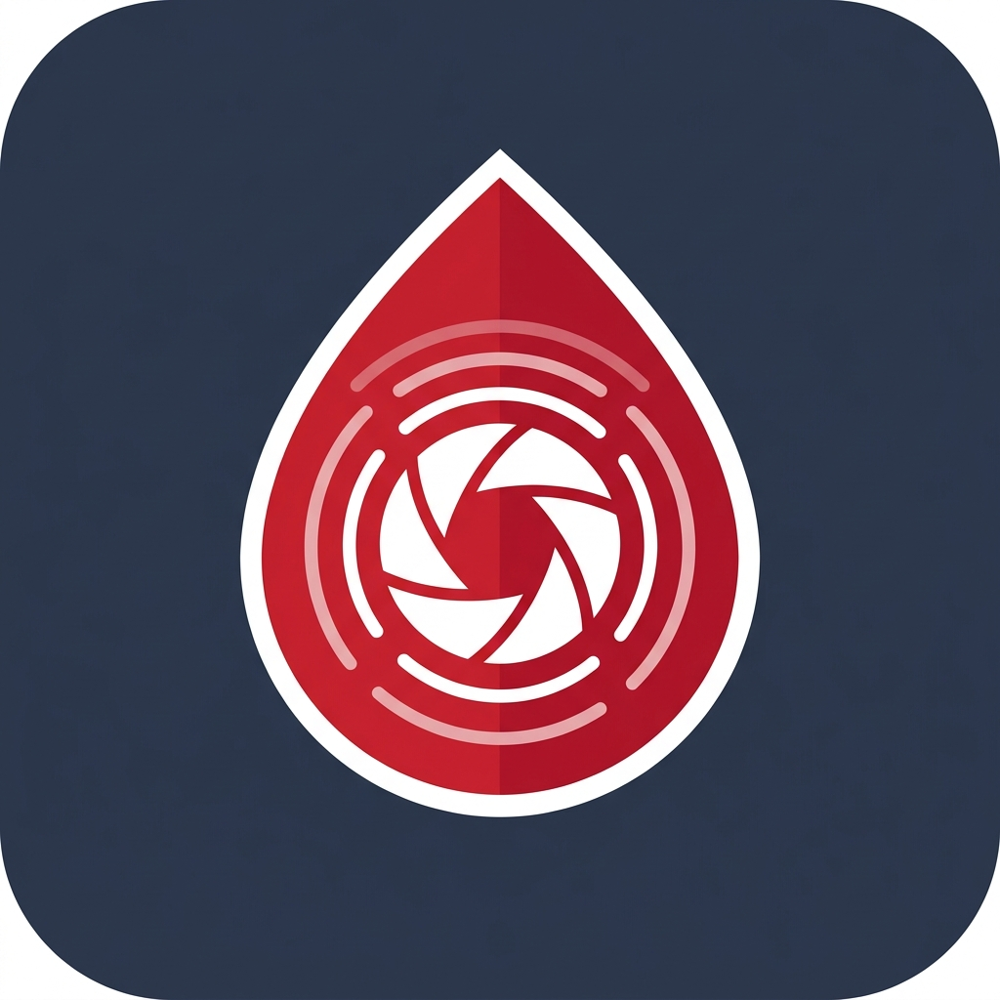

<p align="center">
  
</p>

# HemoScan AI — Detección No Invasiva de Anemia en Android (Kotlin)

Aplicación móvil nativa en **Kotlin** con **Jetpack Compose** y **TensorFlow Lite** para la detección y estimación no invasiva de hemoglobina y anemia en tiempo real, diseñada con arquitectura **Offline-First**, lenguaje comprensible para usuarios no médicos y optimizada para operar de forma privada en el propio dispositivo.

> 📚 **Documentación del Proyecto:**
> - [📄 Paper Científico y Arquitectura Técnica (PAPER.md)](PAPER.md)
> - [📋 Historias de Usuario y Criterios BDD (USER_STORIES.md)](USER_STORIES.md)
> - [🧠 Pipeline de Entrenamiento ML y Datasets (training/README.md)](training/README.md)
> - [🛡️ Memoria de Calidad Clean Code y SonarQube (.quality/README.md)](.quality/README.md)

---

## 🎯 Características Principales

### 1. Inferencia 100% Local (Edge AI) & Privacidad
* **Ejecución Local:** Todo el procesamiento neuronal y colorimétrico se realiza dentro del teléfono mediante TFLite, sin subir imágenes a la nube ni vulnerar la privacidad del usuario.
* **Uso Personal y Seguro:** Interfaz centrada exclusivamente en el dueño del dispositivo (*"Tu Chequeo de Hemoglobina • 100% Privado"*), eliminando saludos ficticios o perfiles innecesarios.

### 2. Switch Inteligente entre Motores de IA
* **Gama Baja / Económica (< 3.5 GB RAM o Android Go):**  
  Activa automáticamente **MobileNetV3 Cuantizado (INT8)**.  
  * Consumo: **0.22 GFLOPs** (15× menos cómputo).  
  * Tamaño binario: **1.16 MB**.  
  * Métricas: **90.88% AUC-ROC / 82.98% Exactitud / 85.17% Especificidad** (MAE = 2.15 g/dL, latencia ~28 ms).
* **Gama Media y Alta (≥ 4.0 GB RAM):**  
  Activa automáticamente **HemaViT (Vision Transformer + FPN)**.  
  * Consumo: **3.28 GFLOPs**.  
  * Tamaño binario: **1.28 MB** INT8.  
  * Métricas: **95.64% AUC-ROC / 88.54% Exactitud / 93.39% Especificidad / 90.00% Sensibilidad** (MAE = 1.42 g/dL, latencia ~32 ms).
* **Motor Clínico Calibrado (Manual):** Modo analítico determinista basado en índices de eritema y relaciones cromáticas biomédicas.

### 3. Protocolos de Captura Guiada
* **Modo Guiado (4 Fotos - Recomendado):** Protocolo binocular/bilateral con descarte inteligente de outliers y reducción de varianza en un 50% ($SE = \sigma / \sqrt{N}$).
* **Modo Rápido (1 Foto):** Triage instantáneo en segundos para chequeos rápidos.
* **Lenguaje Accesible:** Reemplazo de términos clínicos confusos por expresiones cotidianas:
  * *"Interior del Ojo (Párpado inferior)"* en lugar de conjuntiva palpebral.
  * *"Uña de la Mano (Sin esmalte)"* en lugar de lecho ungueal.
  * *"IA Local"* en lugar de neuronal.
* **Guía Visual Integrada:** Diálogo con ilustraciones paso a paso, Do's & Don'ts y recomendaciones de iluminación ambiental.

### 4. Herramientas Rápidas de Salud
* **Guía de Alimentos con Hierro:** Catálogo interactivo dividido en:
  * *Hierro Hemo* (origen animal, alta absorción: sangrecita, hígado, bazo, carnes rojas).
  * *Hierro No Hemo* (origen vegetal: lentejas, espinacas, garbanzos).
  * *Potenciadores* (Vitamina C para multiplicar la asimilación).
  * *Inhibidores* (Café, té y lácteos inmediatamente tras la comida).
* **Compartir Resumen:** Integración con el menú nativo de Android (`Intent.ACTION_SEND`) para exportar reportes legibles por WhatsApp, correo o notas médicas.

### 5. Historial Offline y Respaldo Opcional en la Nube
* **Almacenamiento Local Seguro:** Todos los chequeos se guardan instantáneamente en memoria interna privada con operaciones sincronizadas (`@Synchronized`).
* **Borrado Individual:** Permite eliminar chequeos puntuales con confirmación previa.
* **Sincronización Inteligente (`CloudSyncManager`):** Detección de conectividad en tiempo real. Indica el estado (`📱 Móvil` vs `☁️ Nube`) y sincroniza únicamente cuando hay conexión a internet estable.

---

## 📁 Arquitectura del Código

```
anemia-detection/
├── app/
│   ├── src/main/
│   │   ├── java/com/anemia/detection/
│   │   │   ├── MainActivity.kt               # Entrypoint de la aplicación
│   │   │   ├── MainNavigation.kt             # Navegación Compose entre pantallas
│   │   │   ├── models/
│   │   │   │   ├── DeviceTier.kt             # Perfiles de hardware y modos de IA
│   │   │   │   ├── PatientProfile.kt         # Criterios y umbrales de normalidad OMS
│   │   │   │   └── DetectionResult.kt        # Entidad de resultado (Hb, severidad, isSynced)
│   │   │   ├── engine/
│   │   │   │   ├── DeviceProfiler.kt         # Detección de RAM, núcleos y GPU
│   │   │   │   ├── ImagePreprocessor.kt      # Normalización 224x224 y control de luz
│   │   │   │   └── AnemiaInferenceEngine.kt  # Motor TFLite sin fugas de memoria (.use)
│   │   │   ├── storage/
│   │   │   │   ├── HistoryRepository.kt      # Persistencia thread-safe sincronizada
│   │   │   │   └── CloudSyncManager.kt       # Sincronización a la nube con validación de red
│   │   │   ├── ui/
│   │   │   │   ├── components/
│   │   │   │   │   ├── HemoglobinGauge.kt    # Tacómetro visual de Hemoglobina
│   │   │   │   │   ├── HardwareInfoCard.kt   # Tarjeta de diagnóstico de hardware
│   │   │   │   │   ├── NutritionGuideDialog.kt # Modal interactivo de nutrición y hierro
│   │   │   │   │   ├── VisualCaptureGuideDialog.kt # Guía ilustrada de captura
│   │   │   │   │   └── ScanOptionsComponents.kt # Tarjetas modulares de selección y pasos
│   │   │   │   └── screens/
│   │   │   │       ├── HomeScreen.kt         # Dashboard principal personal
│   │   │   │       ├── ScanScreen.kt         # Pantalla de escáner y fotos
│   │   │   │       ├── ResultScreen.kt       # Tacómetro, diagnóstico y recomendaciones
│   │   │   │       ├── HistoryScreen.kt      # Historial con badges y borrado individual
│   │   │   │       └── SettingsScreen.kt     # Criterios OMS, nube y diagnóstico IA
│   │   │   └── theme/                        # Paleta médica Material 3 y tipografía
│   │   ├── assets/models/                    # Modelos neuronales TFLite INT8
│   │   │   ├── hemavit_anemia_quant.tflite   # 1.28 MB (AUC 95.64%)
│   │   │   └── mobilenetv3_anemia_quant.tflite # 1.16 MB (AUC 90.88%)
│   │   └── AndroidManifest.xml
│   └── build.gradle.kts
├── .quality/                                 # Memoria canónica de auditoría Clean Code
│   ├── README.md                             # Resumen de calidad y Quality Gate
│   ├── quality-tech-debt.md                  # Tablero maestro de deuda técnica
│   ├── metrics.md                            # Métricas de cobertura, complejidad y recursos
│   ├── findings/                             # Registro individual de hallazgos
│   └── standards/                            # Reglas SonarQube cacheadas (Kotlin)
└── HemoScan_AI_debug.apk                     # APK compilado listo para instalar
```

---

## 🛡️ Estándar de Calidad de Código (`.quality/`)

El proyecto fue auditado y saneado bajo directrices **Clean Code de SonarQube** mediante la habilidad `code-quality`:

| ID | Severidad | Regla | Estado |
|---|---|---|---|
| **QLT-0001** | 🔴 Blocker | `kotlin:S2095` (Cierre determinista de descriptores nativos en TFLite) | **Resuelto** ✅ |
| **QLT-0002** | 🟠 High | `kotlin:S2885` / `kotlin:S1192` (Persistencia thread-safe atómica en `HistoryRepository`) | **Resuelto** ✅ |
| **QLT-0003** | 🟡 Medium | `kotlin:S3776` / `kotlin:S104` (Modularización de `ScanScreen` en `ScanOptionsComponents`) | **Resuelto** ✅ |

* **Quality Gate:** **PASSED** ✅ (0 deuda técnica pendiente).

---

## 🚀 Compilación, Pruebas y Despliegue

### 1. Compilar APK de Depuración
```powershell
.\gradlew.bat assembleDebug
```
El APK se genera en: `app/build/outputs/apk/debug/app-debug.apk` y se copia en la raíz como [`HemoScan_AI_debug.apk`](HemoScan_AI_debug.apk).

### 2. Ejecutar Pruebas Unitarias
```powershell
.\gradlew.bat testDebugUnitTest
```
* Resultado: **24 tareas ejecutadas / 100% exitosas**.

### 3. Instalar en Teléfono o Emulador
```powershell
adb install -r HemoScan_AI_debug.apk
```

---

## 🔬 Referencias Científicas

1. **HemaViT:** *Transformer-based deep learning for automated non-invasive anemia detection using conjunctival imaging.* (Scientific Reports, 2026).
2. **Smartphone Anemia App:** *Smartphone app for non-invasive detection of anemia using only patient-sourced photos.* (Nature Communications, 2018).
3. **WHO Guidelines:** *Haemoglobin concentrations for the diagnosis of anaemia and assessment of severity.* (World Health Organization, 2011).
